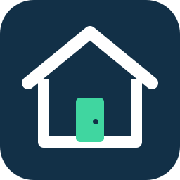

# RentSmart

Desarrollamos RentSmart, un proyecto académico de Pruebas de Software para conectar personas que ofrecen espacios con quienes necesitan arrendarlos.



## Entrega 1

- [Integrantes y responsabilidades](#equipo).
- [Wiki del proyecto publicada](https://github.com/JorgeJaceval/Pruebas-De-Software-RentSmart/wiki), con instalación, alcance, arquitectura, pruebas y supuestos. Conservamos su [fuente versionada](docs/wiki/README.md).
- [Resumen de Entrega 1](docs/resumen-entrega-1.md).
- [Recorrido integrado ejecutado: CRUD y reserva](docs/testing/recorrido-final-entrega-1.md).
- [Alcance y evidencias de Entrega 1](docs/entrega-1.md).
- [Video de presentación de Entrega 1](https://drive.google.com/file/d/17H2e4SKm3GOre0F0W0TxGIGKeGdF53n1/view?usp=sharing).
- Versión de entrega: [`v1.0-entrega1`](https://github.com/JorgeJaceval/Pruebas-De-Software-RentSmart/releases/tag/v1.0-entrega1), sobre `main`. Consulta las [notas de la versión](docs/releases/entrega-1.md). Fecha de preparación: **12 de octubre de 2026**.

## Entrega 2

- [Objetivo, alcance, infraestructura, pipeline y evidencia para la Wiki](docs/wiki/Entrega-2.md).
- [Registro acumulativo de trabajo](docs/entrega-2.md) y [lista de cierre con pendientes reales](docs/cierre-entrega-2.md).
- [Guía de despliegue](docs/despliegue.md), [preparación real del VPS de Azure](docs/vps-azure.md), [cómo obtener sus datos](docs/preparar-vps.md) y [Slack configurado y verificado](docs/notificaciones-slack.md).
- [Guion preparado para el video](docs/guion-video-entrega-2.md) y [borrador de notas de versión](docs/releases/entrega-2.md).

PR #28 incorporó en `main` los avances revisados de HU-14/HU-16 y CI/CD. [RentSmart está publicado por HTTPS](https://rentsmart-usm-viveros.chilecentral.cloudapp.azure.com), revisión `ff19bc3`, mediante Actions y el ambiente `production` limitado a `main`; [registramos el despliegue y sus verificaciones](docs/evidencias/REN-84-despliegue-2026-10-29.md). `DEPLOY_ENABLED=true`. La Wiki actualizada, el video y el tag/Release `v2.0-entrega2` siguen pendientes. CA-05 de HU-14 conserva cancelación pendiente y no incorporamos HU-15 por esa dependencia. Las pruebas E2E/UI y los requisitos finales de entrega 3 quedan fuera de este avance. La [lista de cierre](docs/cierre-entrega-2.md) distingue publicación de aplicación y entrega final.

## Equipo

| Integrante | Rol | Responsabilidades |
| --- | --- | --- |
| Jorge Aceval | Líder de equipo y responsable de backend e integración | Coordinar tareas y entregas; administrar el repositorio y GitFlow; desarrollar la API con FastAPI, los modelos con SQLModel y la persistencia en PostgreSQL; implementar pruebas con Pytest y configurar CI/CD con GitHub Actions. |
| Joaquín Viveros | Responsable de frontend y pruebas de interfaz | Desarrollar la interfaz con React, TypeScript y Vite; integrar el frontend con la API; implementar pruebas con Jest y React Testing Library y preparar las E2E con Playwright para la entrega 3. |

Entre ambos mantenemos la documentación, verificamos los criterios de aceptación y revisamos los pull requests del otro antes de integrarlos.

Usamos **Discord** para coordinar el trabajo y **Jira** para gestionar las historias, criterios y pruebas. Nuestro equipo está compuesto por **dos integrantes**, con autorización docente. La distribución de responsabilidades se describe en [organización y comunicación](docs/organizacion.md).

## Tecnologías seleccionadas

Elegimos las siguientes tecnologías para desarrollar y probar la aplicación:

| Área | Tecnología |
| --- | --- |
| Frontend | React, TypeScript y Vite |
| Backend | Python y FastAPI |
| Base de datos | PostgreSQL y SQLModel ORM |
| Pruebas frontend | Jest y React Testing Library |
| Pruebas backend | Pytest |
| Pruebas E2E previstas para entrega 3 | Playwright |
| CI/CD | GitHub Actions |
| Despliegue preparado para entrega 2 | Servidor Linux, Docker Compose y Caddy con HTTPS |

La [guía de despliegue de entrega 2](docs/despliegue.md) describe producción, variables, secretos SSH, verificación y recuperación. Conservamos el Compose local y uno independiente para el servidor. El despliegue está activo después de `quality` y `production`, únicamente desde `main`; los PR y `develop` no publican. Verificamos cada publicación por su propio SHA y readiness.

Configuramos [notificaciones del resultado de CI/CD a Slack](docs/notificaciones-slack.md) para `#rentsmart-ci`, con `SLACK_WEBHOOK_URL` guardado como secreto del repositorio. Slack aceptó los avisos reales de éxito y fallo artificial y el usuario confirmó la recepción de ambos; la guía conserva los enlaces de evidencia. Cuando el secreto no esté disponible, Actions registra la notificación como omitida, sin afirmar que envió un mensaje.

## Funcionalidades disponibles

Hasta ahora implementamos:

- Página inicial en React y TypeScript, servida por Vite, con estado de disponibilidad y reintento ante fallos.
- Registro de cuentas (HU-01 / REN-1): formulario con nombre, correo y contraseña, validaciones por campo y confirmación de registro.
- Inicio y cierre de sesión (HU-02 / REN-2): acceso con correo y contraseña, sesión de 30 minutos, recuperación tras recargar y navegación privada según los permisos de la cuenta.
- Publicación de espacios (HU-03 / REN-3): formulario con datos, tarifa por hora en CLP, horario y fotos por URL HTTPS; publicación activa asociada a la cuenta y recuperación del espacio creado tras recargar.
- Edición de espacios propios (HU-04 / REN-4): carga de datos actuales, guardado validado y cancelación; conserva identidad, estado y condiciones económicas de las reservas existentes.
- Activación y desactivación (HU-05 / REN-5): acción explícita desde el espacio propio, estado persistido y bloqueo de reactivación de retiros administrativos; consulta pública que excluye espacios inactivos o retirados.
- Eliminación de espacios (HU-06 / REN-6): confirmación con el nombre del espacio y eliminación solo para su propietario cuando no existe ninguna reserva histórica; si hay reservas, ofrecemos desactivar y conservarlas.
- Mis espacios (HU-07 / REN-7): listado privado de publicaciones propias activas, inactivas y retiradas, con foto, precio, estado y acciones de gestión; distinguimos carga, vacío y error, y actualizamos las tarjetas después de operaciones confirmadas. Desde las tarjetas accedemos a las reservas recibidas mediante HU-14. Alcance en [HU-07](docs/HU-07.md).
- Catálogo público (HU-08 / REN-8): tarjetas de publicaciones activas no retiradas, foto principal y precio por hora; estados de carga, vacío y error con reintento y enlace a un resumen público.
- Búsqueda y filtros básicos (HU-09 / REN-9, parcial): nombre o descripción, tipo, comuna, precio y capacidad; orden por precio y limpieza. El filtro temporal del catálogo sigue pendiente de conectarse a las reglas de HU-11/12. Alcance en [HU-09](docs/HU-09.md).
- Detalle de espacios (HU-10 / REN-10): datos completos y galería, horario en Santiago y acceso con retorno al mismo espacio; identifica publicaciones propias y permite lectura privada de inactivos a dueño/administrador. La selección se conecta con HU-12. Alcance en [HU-10](docs/HU-10.md).
- Horario disponible (HU-11 / REN-11): apertura y cierre diarios en horas enteras de Santiago, protección de reservas vigentes al editar y validación compartida de intervalos bajo el bloqueo del espacio. HU-12 verifica la concurrencia con solicitudes reales de reserva. Alcance en [HU-11](docs/HU-11.md).
- Reservar un horario (HU-12 / REN-12): fecha y horas con duración y total estimado; reserva autenticada de otro espacio, validación de horario y superposición, precio contratado y pago pendiente guardados conjuntamente, plazo máximo de 15 minutos y confirmación privada recuperable al recargar. Alcance en [HU-12](docs/HU-12.md).
- Mis reservas y pagos (HU-13 / REN-13, parcial): panel privado con reservas vigentes e historial, importes contratados, estados efectivos, vencimiento y actualización; conserva registros antiguos y espacios inactivos. El pago simulado se ejecuta mediante HU-16; la cancelación depende de HU-15. Alcance y decisiones en [HU-13](docs/HU-13.md).
- Reservas recibidas (HU-14 / REN-14): panel privado del propietario con filtro por espacio, arrendatario, importes contratados, estados efectivos, próximas e historial. Incluye publicaciones inactivas o retiradas. La cancelación depende de HU-15. Alcance en [HU-14](docs/HU-14.md).
- Pago simulado (HU-16 / REN-16): aprobación o rechazo explícitos sin dinero real ni datos de tarjeta; referencia estable, importe contratado y fecha persistidos, reintento tras rechazo e idempotencia de aprobación. Alcance en [HU-16](docs/HU-16.md).
- API FastAPI con configuración por variables de entorno, CORS y documentación OpenAPI.
- Persistencia PostgreSQL mediante SQLModel y migraciones Alembic. Los correos se normalizan y son únicos; las contraseñas se almacenan como hashes Argon2.
- Docker Compose para iniciar los tres servicios.
- Pruebas con Jest/React Testing Library y Pytest; GitHub Actions las ejecuta en cada PR hacia `develop` o `main` y tras integrar cambios en esas ramas. Las pruebas E2E con Playwright se reservan para la entrega 3.

En la página, selecciona **Crear cuenta** y completa los tres campos. El nombre debe tener entre 2 y 80 caracteres y la contraseña entre 8 y 64. Los errores conservan los datos del formulario para corregirlos. Un correo ya registrado muestra un mensaje junto al campo correspondiente. Después de la confirmación puedes seleccionar **Iniciar sesión**; el registro no autentica automáticamente.

Al iniciar sesión aparecen **Mis espacios** y **Mis reservas**. **Mis espacios** muestra las publicaciones de tu cuenta, incluidas las inactivas y retiradas. Desde el panel, selecciona **Publicar espacio**, completa el formulario y revisa la confirmación. Comenzamos con un horario editable de 09:00 a 18:00 y exigimos entre una y tres URLs HTTPS para las fotos. El espacio creado puede recuperarse tras recargar su vista privada; al volver al panel consultamos nuevamente el listado. Desde cada tarjeta puedes abrir **Ver espacio** o **Editar espacio**, o **Desactivar publicación** / **Activar publicación** para cambiar su estado. Confirmamos el cambio después de guardarlo. **Eliminar espacio** solicita confirmación y permite cancelar. Si existen reservas, conserva la publicación y ofrece **Desactivar y conservar**; esa alternativa requiere una acción explícita. **Consultar reservas** abre el panel del propietario filtrado por esa publicación; **Ver todas las reservas recibidas** permite consultar y filtrar todos sus espacios.

`GET /api/spaces/mine` requiere sesión y devuelve solo las publicaciones de la cuenta autenticada. Los parámetros de propietario no permiten consultar un panel ajeno. Una lista vacía ofrece publicar; un fallo permite reintentar sin mostrar un vacío falso.

Selecciona **Explorar catálogo** para consultar publicaciones sin iniciar sesión. Cada tarjeta muestra nombre, foto principal, tipo, comuna, capacidad y precio en CLP/h. El enlace abre el detalle con descripción, todas las fotos, ubicación, condiciones y horario diario en Santiago. Desde **Iniciar sesión para reservar** volvemos al mismo espacio después del acceso. Una publicación visible no garantiza disponibilidad para una fecha y hora. Sobre el listado completo y pequeño de demostración puedes buscar por nombre o descripción, combinar tipo, comuna, rango de precio y capacidad mínima, ordenar por precio y limpiar los filtros. HU-09 conserva pendiente el filtro por fecha y horario.

`GET /api/spaces` sirve el catálogo y `GET /api/spaces/public/{id}` su lectura pública individual. `GET /api/spaces/{id}/detail` añade el contexto de la cuenta autenticada y permite al dueño o administrador leer inactivos con aviso de estado. La vista no ofrece reservar espacios propios. Elige fecha, inicio y término para revisar duración y total estimado. Desde **Solicitar reserva**, la API comprueba disponibilidad y precio actuales y muestra el contrato guardado. Conservamos la selección al iniciar sesión y los datos ante errores; una reserva no anuncia un pago realizado.

`POST /api/reservations` recibe únicamente espacio, fecha y horas, en horario de Santiago. El backend calcula cuenta, precio, duración, total y vencimiento, y guarda reserva y pago pendiente en una sola transacción. Aceptamos inicios futuros hasta 90 días después del instante actual, con intervalos enteros de 1–8 horas en un mismo día. Las reservas consecutivas son válidas; dos solicitudes simultáneas del mismo intervalo producen una reserva y un conflicto. El plazo para pagar es el menor entre creación + 15 minutos e inicio; las pendientes vencidas dejan de bloquear aunque su estado almacenado aún no haya cambiado.

La confirmación `#reserva/{id}` se recupera mediante `GET /api/reservations/{id}`, disponible solo para su arrendatario, y muestra el estado efectivo del servidor. Allí conservamos identificador, espacio, fecha, horario, duración, precio contratado, total y plazo de pago. Desde **Mis reservas**, `GET /api/reservations` recupera únicamente las reservas de la cuenta verificada: **Próximas y en curso** primero e **Historial** después. **Actualizar reservas y pagos** vuelve a comprobar los estados en el servidor. Conservamos precios acordados y presentamos los horarios antiguos con sus minutos o fracciones, incluso si la publicación quedó inactiva. Una cuenta sin reservas muestra un mensaje diferente de un fallo de consulta.

El acceso a **Administración** requiere una cuenta con permisos administrativos en PostgreSQL. Al cerrar sesión o vencer su vigencia, la interfaz vuelve a solicitar el acceso. El panel del propietario (HU-14) ya permite consultar reservas recibidas; la cancelación (HU-15) y administración de publicaciones continúan pendientes. HU-13 ofrece pagar mediante HU-16 y conserva cancelar deshabilitado; CA-03 queda parcial por HU-15.

El horario de apertura y cierre se aplica todos los días en la zona horaria de Santiago. Aceptamos horas enteras de un mismo día, con apertura menor que cierre y cierre máximo a las 23:00. Al editar, un horario que excluya una reserva pagada vigente o una pendiente aún válida recibe un conflicto y conserva todos los datos anteriores. Las reservas canceladas, expiradas, finalizadas o vencidas por tiempo no bloquean el cambio. Conservamos el horario inicial editable de 09:00–18:00.

Desde **Mis reservas** o el resumen individual, **Pagar reserva** abre `#pago/{id}`. Revisamos el importe contratado, elegimos aprobar o rechazar y confirmamos la simulación. Un rechazo permite reintentar mientras el plazo siga vigente. **Actualizar reserva** comprueba el estado si hubo un resultado incierto.

`POST /api/reservations/{id}/payment` recibe únicamente `result: "approved"` o `"rejected"`. Solo paga el arrendatario; el backend decide importe, vigencia y estado. Aprobación y reserva pagada se guardan juntas. Repetir una aprobación devuelve la misma referencia, importe y fecha, y un rechazo posterior no la revierte. El resumen y Mis reservas muestran el resultado persistido.

La migración `0006_payment_simulation` agrega importe y fecha de procesamiento al pago sin inventarlos para registros anteriores. Compose aplica las migraciones al iniciar; en ejecución local aplica `uv run alembic upgrade head` antes de iniciar la API.

`GET /api/reservations/received` devuelve solo reservas de espacios de la cuenta propietaria, con el nombre del arrendatario y sin correo ni credenciales. Acepta `space_id` para filtrar por una publicación propia y mantiene los importes contratados. Un filtro ajeno o inexistente recibe `404`. Los administradores están sujetos al mismo filtro de propiedad. La consulta individual del arrendatario conserva sus permisos.

## Obtener el proyecto

```bash
git clone https://github.com/JorgeJaceval/Pruebas-De-Software-RentSmart.git
cd Pruebas-De-Software-RentSmart
git switch --detach v1.0-entrega1
```

## Ejecutar con Docker Compose

Requiere Docker con Compose. En Windows, inicia Docker Desktop con el motor de contenedores Linux.

Desde la raíz del repositorio, copia el ejemplo si todavía no tienes `.env`:

```bash
cp .env.example .env
```

Genera una clave aleatoria para firmar las sesiones, por ejemplo con:

```bash
docker run --rm python:3.12-slim python -c "import secrets; print(secrets.token_hex(32))"
```

Coloca el valor generado en `AUTH_SECRET_KEY` dentro de `.env`. La clave debe tener al menos 32 caracteres y se conserva entre reinicios; no la publiques ni la agregues al repositorio. `AUTH_TOKEN_MINUTES` define la vigencia, con 30 minutos por defecto. Después inicia los servicios:

```bash
docker compose up --build -d --wait
```

Abre:

| Servicio | Dirección |
| --- | --- |
| Aplicación | <http://localhost:5173> |
| Documentación de la API | <http://localhost:8000/docs> |
| Estado de la API | <http://localhost:8000/api/health> |
| Estado de la API y PostgreSQL | <http://localhost:8000/api/health/ready> |

PostgreSQL se publica en `127.0.0.1:15432`. Su puerto interno es `5432`; los datos se conservan en el volumen `postgres_data`. Las credenciales de los ejemplos son para desarrollo local.

El backend aplica `alembic upgrade head` antes de iniciar. Esto crea las tablas de cuentas, espacios, reservas y pagos con sus restricciones sin borrar los datos existentes. La migración de HU-12 completa las reservas anteriores con duración derivada y una fecha de creación estimada; conserva sus importes y no inventa pagos históricos. El detalle de compatibilidad está en [HU-12](docs/HU-12.md).

Para consultar el estado, los registros o detener los servicios conservando los datos:

```bash
docker compose ps
docker compose logs backend frontend
docker compose down
```

## Desarrollo local

Requiere Node.js 24 y [uv](https://docs.astral.sh/uv/getting-started/installation/). uv instala Python 3.12 y crea el entorno del backend. En PowerShell, `cp` también funciona; usa `npm.cmd` y `npx.cmd` si la política de ejecución bloquea `npm.ps1` o `npx.ps1`.

1. Prepara el `.env` de la raíz y su `AUTH_SECRET_KEY` como indicamos arriba. Inicia solo PostgreSQL:

```bash
docker compose up -d --wait db
```

2. En una terminal, prepara `backend/.env` si todavía no existe y copia allí la misma `AUTH_SECRET_KEY` de la raíz. Instala e inicia el backend:

```bash
cd backend
cp .env.example .env
uv sync --frozen
uv run alembic upgrade head
uv run uvicorn app.main:app --reload --host 127.0.0.1 --port 8000
```

3. En otra terminal, desde la raíz, instala e inicia el frontend:

```bash
cd frontend
cp .env.example .env
npm ci
npm run dev -- --host 127.0.0.1
```

Vite envía las solicitudes `/api` al backend a través de un proxy. `API_PROXY_TARGET` permite cambiar su destino y es una variable del servidor de desarrollo; no contiene secretos ni se incorpora al navegador.

Los archivos `.env.example` documentan las variables de cada servicio. Si cambias usuario, contraseña, base de datos o puerto de PostgreSQL en el `.env` de la raíz, actualiza también `backend/.env` para la ejecución local. Docker Compose transmite estas variables automáticamente al backend dentro del contenedor.

## Ejecutar las pruebas

Con PostgreSQL iniciado, instala las dependencias de backend y frontend como se indica arriba.

Frontend, desde `frontend`:

```bash
npm run test:ci
```

Backend, desde `backend`:

```bash
uv run pytest -q
```

Para probar la API usamos Pytest y PostgreSQL real en un esquema independiente por prueba. Aplicamos las migraciones y eliminamos el esquema al terminar. El usuario de pruebas necesita permiso para crear esquemas. Para el formulario usamos Jest y React Testing Library en jsdom, con solicitudes HTTP simuladas.

Registramos los casos y resultados en **CP** y **Testing** del [proyecto Jira REN](https://rentsmartpsf.atlassian.net/jira/software/projects/REN). Conservamos la relación entre criterio, caso y comprobación automatizada, y distinguimos los criterios pendientes en las historias parciales. Los PR y GitHub Actions conservan la evidencia de ejecución.

La [CI del tag de entrega](https://github.com/JorgeJaceval/Pruebas-De-Software-RentSmart/actions/runs/38326696945), sobre `5c0fabc` del 12 de octubre de 2026, registró **98 pruebas Jest en 11 suites y 114 Pytest aprobadas**, junto con build y comprobación de migraciones. Son **212 comprobaciones automatizadas**; hay **99 CP lógicos documentados**, de los cuales tres están planificados y no ejecutados. Un CP puede tener varias comprobaciones. Consulta [la evidencia de Entrega 1](docs/entrega-1.md) y el detalle de [HU-09](docs/testing/HU-09.md), [HU-10](docs/testing/HU-10.md) y [HU-13](docs/testing/HU-13.md).

Además, ejecutamos [13 pasos del recorrido integrado](docs/testing/recorrido-final-entrega-1.md) en navegador contra API y PostgreSQL reales: registro, acceso, CRUD, reserva, conflicto y Mis reservas. El informe incluye el procedimiento, los resultados y el registro HTTP. Presentamos esta evidencia manual por separado de las pruebas automatizadas.

Para entrega 2, la [CI #40796675009](https://github.com/JorgeJaceval/Pruebas-De-Software-RentSmart/actions/runs/40796675009), del PR sobre `d3553a8`, aprobó **134 Jest y 144 Pytest**, además de **26 pruebas de infraestructura** y smoke de contenedores. La [sonda #40796674640](https://github.com/JorgeJaceval/Pruebas-De-Software-RentSmart/actions/runs/40796674640) aprobó esos tests de aplicación y falló deliberadamente después de ellos; Slack recibió ambos avisos, confirmados por el usuario. Los resultados identifican revisiones concretas y se mantienen separados de los de entrega 1 y del candidato final aún pendiente.

### Playwright: entrega 3

Reservamos las pruebas E2E para la entrega 3 y conservamos la dependencia, el script y la configuración de Playwright para prepararlas. Actualmente no tenemos casos E2E en el repositorio ni ejecutamos Playwright en el pipeline.

Para compilar y visualizar el frontend compilado, con el backend disponible:

```bash
npm run build
npm run preview -- --host 127.0.0.1
```

La vista compilada se sirve en <http://localhost:4173>. `compose.yaml` conserva el entorno de desarrollo local; `compose.production.yaml` prepara el servidor con Caddy según la guía de despliegue.

## Estructura

```text
backend/
  app/             API, configuración y sesiones SQLModel
  migrations/      Historial Alembic del esquema de PostgreSQL
  alembic.ini      Configuración de migraciones
  tests/           Pruebas de API y PostgreSQL
  pyproject.toml   Dependencias Python
  uv.lock          Versiones resueltas de Python
frontend/
  src/             Interfaz, cliente API y pruebas Jest
  package-lock.json
docs/              Documentación e identidad
compose.yaml       PostgreSQL, backend y frontend
compose.production.yaml  Configuración independiente para Linux/Caddy
.github/workflows/ci.yml
```

Consulta [la arquitectura y configuración de la base](docs/desarrollo.md) para entender los servicios y resolver problemas de arranque.

## Flujo de trabajo

El flujo GitFlow acordado usa `main` para las versiones estables, `develop` para integrar el desarrollo y ramas `feature/REN-<numero>-<descripcion>` que parten desde `develop`. Proponemos los cambios de desarrollo mediante un pull request para que los revise el otro integrante. Las ramas `release/*` preparan entregas y `hotfix/*` corrigen versiones estables.

Incluimos la clave exacta de Jira en el nombre de la rama, los mensajes de commit y el título del PR. También enlazamos la tarea en la descripción. Por ejemplo, la configuración del repositorio corresponde a [REN-27](https://rentsmartpsf.atlassian.net/browse/REN-27).

Consulta la [guía de contribución](CONTRIBUTING.md) para los comandos, revisión y criterios de integración.

## Documentación y enlaces

- [Repositorio](https://github.com/JorgeJaceval/Pruebas-De-Software-RentSmart)
- [Wiki](https://github.com/JorgeJaceval/Pruebas-De-Software-RentSmart/wiki) y [contenido versionado](docs/wiki/README.md).
- [Entrega 1: alcance y evidencias](docs/entrega-1.md).
- [Arquitectura y desarrollo local](docs/desarrollo.md).
- [Registro acumulativo y pipeline de entrega 2](docs/entrega-2.md).
- [Cierre de entrega 2 y matriz de la pauta](docs/cierre-entrega-2.md).
- [Tarea REN-73](https://rentsmartpsf.atlassian.net/browse/REN-73).
- [Implementación de HU-01 / REN-1](docs/HU-01.md).
- [Implementación de HU-02 / REN-2](docs/HU-02.md).
- [Implementación de HU-03 / REN-3](docs/HU-03.md).
- [Implementación de HU-04 / REN-4](docs/HU-04.md).
- [Implementación de HU-05 / REN-5 y dependencias](docs/HU-05.md).
- [Implementación de HU-06 / REN-6](docs/HU-06.md).
- [Implementación de HU-07 / REN-7 y acceso a reservas recibidas](docs/HU-07.md).
- [Implementación de HU-08 / REN-8](docs/HU-08.md).
- [Implementación parcial de HU-09 / REN-9](docs/HU-09.md).
- [Implementación de HU-10 / REN-10](docs/HU-10.md).
- [Implementación de HU-11 / REN-11](docs/HU-11.md).
- [Implementación de HU-12 / REN-12](docs/HU-12.md).
- [Implementación de HU-13 / REN-13 y dependencias de pago y cancelación](docs/HU-13.md).
- [Implementación de HU-14 / REN-14](docs/HU-14.md).
- [Implementación de HU-16 / REN-16](docs/HU-16.md).
- [Requerimientos, reglas de negocio y casos de uso](docs/requerimientos.md).
- [Identidad y configuración de la organización](docs/organizacion.md).
- [Requisitos de entrega 1](https://github.com/Pruebas-de-Software/HandsOnProject/blob/main/semestres/2026-2/entrega1.md).
- [Tema RentSmart](https://github.com/Pruebas-de-Software/HandsOnProject/blob/main/semestres/2026-2/tema1.md).

## Contacto y contribución

Somos Jorge Aceval y Joaquín Viveros, responsables del proyecto. Recibimos consultas, propuestas y reportes de errores mediante los [issues del repositorio](https://github.com/JorgeJaceval/Pruebas-De-Software-RentSmart/issues). Para contribuir, sigue [CONTRIBUTING.md](CONTRIBUTING.md).

## Licencia

Distribuimos el proyecto bajo la [licencia MIT](LICENSE). Copyright © 2026 Jorge Aceval y Joaquín Viveros.
