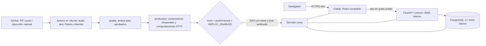

# Despliegue de RentSmart — REN-84

Preparamos GitHub Actions → SSH → servidor Linux con Docker Compose y Caddy. Conservamos React/TypeScript, FastAPI, Alembic y PostgreSQL 17. GitHub Actions es una alternativa admitida en la sección 3.3 de la pauta de entrega 2. Caddy y el VPS son decisiones de implementación del equipo.

La configuración está preparada para revisión. **Todavía no publicamos en un VPS:** faltan host, usuario/puerto SSH, dominio y credenciales del ambiente real. La prueba temporal usa HTTP local; no constituye evidencia de HTTPS público, acceso SSH al servidor ni un despliegue remoto exitoso.

La [guía para obtener los datos del VPS](preparar-vps.md) explica dónde consultar host, usuario, puerto, Docker, dominio/DNS y proxy. Necesitaremos esa ficha antes de conectar el servidor y activar el despliegue; la documentación puede avanzar mientras se reúne.

## 1. Arquitectura prevista



- `compose.yaml` conserva el ambiente de desarrollo. `compose.production.yaml` es independiente: se utiliza solo, sin combinar ambos archivos.
- La imagen frontend compila `dist` con Node.js 24. Su contenedor final ejecuta Caddy, sin servidor Vite de desarrollo ni Node en ejecución.
- Caddy sirve la SPA, sus assets y `version.json`; dirige `/api` y `/api/*` a FastAPI conservando el prefijo. Un error de API no se convierte en HTML de la SPA. Solo publicamos TCP 80/443.
- PostgreSQL y FastAPI no publican puertos al host. `postgres_data` conserva datos; `caddy_data` y `caddy_config` conservan estado y certificados. Sus nombres dependen del proyecto Compose fijo `rentsmart-production`.
- Alembic corre como servicio temporal `migrate`, antes de reemplazar API/frontend. La API de producción arranca con Uvicorn sin repetir migraciones al reiniciarse. Los servicios permanentes usan `restart: unless-stopped`.
- Cada imagen de aplicación lleva `org.opencontainers.image.revision`; el frontend publica el SHA completo en `/version.json`, sin caché. La API verifica su conexión con PostgreSQL en `/api/health/ready`.

## 2. Preparar el servidor una vez

Necesitamos un servidor **Linux** con Bash, Docker Engine y Compose plugin v2.24 o superior, OpenSSH Server, Python 3, `curl`, `tar`, `flock` y las utilidades GNU habituales. El runner de Actions usa Ubuntu e incluye Git y cliente OpenSSH. Instalamos Docker siguiendo la documentación de la distribución y verificamos en el VPS:

```bash
docker version
docker compose version
python3 --version
curl --version
flock --version
```

El usuario SSH debe poder ejecutar Docker sin interacción. El servidor construye las imágenes, por lo que requiere salida a Internet para descargar imágenes base y dependencias, además de espacio y memoria disponibles. No necesita un checkout Git, token de GitHub ni acceso al repositorio privado: el runner envía un archivo con el código versionado.

Elegimos un directorio exclusivo de RentSmart, por ejemplo `/opt/rentsmart`, sin espacios ni puntos. Con el usuario de despliegue conectado:

```bash
sudo install -d -m 0750 -o "$USER" -g "$(id -gn)" \
  /opt/rentsmart /opt/rentsmart/shared /opt/rentsmart/releases
install -m 600 /dev/null /opt/rentsmart/shared/.env
```

Completamos ese archivo con la estructura de [`.env.production.example`](../.env.production.example). Generamos contraseña de base de datos y clave de sesión independientes, por ejemplo con `openssl rand -hex 32`. Conservamos permisos `600`. **No usamos `source` sobre el archivo:** Compose lo interpreta como dotenv. Los secretos de la aplicación permanecen en ese archivo del servidor; no se transfieren con el código ni se imprimen con `docker compose config`.

`SITE_ADDRESS` contiene el dominio real, sin esquema ni ruta. Sus registros DNS deben apuntar al VPS y TCP 80/443 deben estar disponibles desde Internet y libres para Caddy. Caddy gestiona los certificados y la redirección HTTP → HTTPS. Si existe otro proxy ocupando esos puertos, acordamos su integración antes de activar esta configuración; no lo reemplazamos automáticamente.

La base y los volúmenes de producción son independientes del Compose local. Un volumen de desarrollo existente no se importa automáticamente. Cambiar `POSTGRES_PASSWORD` en dotenv no cambia la contraseña de una base ya inicializada: la rotación requiere actualizar también PostgreSQL.

## 3. Configurar GitHub y SSH

Creamos el ambiente **production** en GitHub, restringiendo sus ramas de despliegue a `main`. En **Settings → Secrets and variables → Actions**, definimos estas variables del repositorio:

| Variable | Valor o propósito |
| --- | --- |
| `DEPLOY_ENABLED` | `false` durante la preparación; `true` para activar |
| `DEPLOY_HOST` | Dominio SSH o IPv4, sin esquema ni usuario; no admite IPv6 literal |
| `DEPLOY_USER` | Usuario Linux de despliegue |
| `DEPLOY_PORT` | Puerto SSH, por ejemplo `22` |
| `DEPLOY_ROOT` | Directorio preparado, por ejemplo `/opt/rentsmart` |
| `DEPLOY_URL` | URL pública HTTPS sin ruta, por ejemplo `https://rentsmart.example.org` |

En los **secrets del ambiente production** configuramos:

| Secret | Contenido |
| --- | --- |
| `SSH_PRIVATE_KEY` | Clave privada dedicada al despliegue automatizado, sin contraseña interactiva |
| `SSH_KNOWN_HOSTS` | Entrada de host SSH cuya huella verificamos por un canal confiable |

Generamos la clave fuera del repositorio, por ejemplo `ssh-keygen -t ed25519 -f ~/.ssh/rentsmart-deploy -C rentsmart-ci`, y autorizamos solo su parte pública en `authorized_keys` del usuario destino. Comparamos la huella del host con la consola o administrador del VPS antes de guardar `SSH_KNOWN_HOSTS`; para un puerto distinto de 22, la entrada usa `[host]:puerto`. No enviamos claves privadas por chat ni las incorporamos al PR.

El script exige `StrictHostKeyChecking=yes`, `BatchMode=yes` y la identidad dedicada. Las credenciales se materializan en un directorio temporal del runner, con permisos restringidos, y se eliminan al terminar. No ejecutamos `ssh-keyscan` como sustituto de verificar la identidad del servidor.

## 4. Qué ejecuta el pipeline

1. Para PR/push hacia `develop`/`main` y ejecución manual, `frontend` compila y ejecuta Jest; `backend` aplica/comprueba Alembic y ejecuta Pytest contra PostgreSQL temporal.
2. `quality` exige ambos resultados `success`. Las sondas manuales `failure_probe` conservan su propósito de fallo artificial y bloquean las etapas siguientes.
3. `production` depende de `quality`: valida Bash/ShellCheck, ejecuta seis comprobaciones del script de despliegue con Docker simulado, construye las imágenes de producción y prueba migraciones, HTTP, proxy, versión, fallback de SPA y persistencia en recursos temporales. No utiliza credenciales del VPS ni navegador; las E2E/UI siguen reservadas para la entrega 3.
4. `deploy` depende de `quality` y `production`. Solo corre desde `main`, mediante `push` o ejecución manual, y con `DEPLOY_ENABLED=true`. Un PR o push a `develop` nunca despliega. Deshabilitado significa **job omitido**, no publicación exitosa.
5. El runner comprueba que su checkout coincide con `GITHUB_SHA`, empaqueta ese commit mediante `git archive` y lo transfiere por SSH. Excluye archivos locales no versionados y `.git`. Las imágenes se construyen en el VPS desde ese código y los lockfiles; no descargamos artefactos de otro workflow.
6. En el VPS creamos `releases/<SHA>.<sufijo>`. `deploy.sh` valida la configuración, toma un bloqueo con `flock`, construye las imágenes y valida Caddy. Inicia/comprueba PostgreSQL, aplica Alembic y, solo si termina correctamente, reemplaza API/frontend.
7. Esperamos los healthchecks, comprobamos el SHA de ambos contenedores y consultamos públicamente `version.json` y readiness con validación normal de TLS. Solo después actualizamos el enlace `current` y registramos éxito en el resumen de Actions.

El workflow no cancela una ejecución en `main` cuando llega otro push. El job usa además una concurrencia de producción y el servidor rechaza un segundo despliegue simultáneo. Antes de comenzar una release nueva revisamos el estado de cualquier ejecución interrumpida manualmente.

Después de configurar y verificar servidor, DNS y secretos, ponemos `DEPLOY_ENABLED=true`. Un push revisado a `main` despliega automáticamente. Para repetirlo ejecutamos **Actions → Pruebas RentSmart → Run workflow**, rama `main`, `failure_probe=none`. En protección de ramas recomendamos exigir `frontend`, `backend`, `quality` y `production`; definirlos en YAML no configura por sí solo esa protección.

## 5. Comprobar disponibilidad y versión

Desde una máquina con acceso a la URL pública:

```bash
bash scripts/verify-deployment.sh https://DOMINIO SHA_COMPLETO_DE_40_CARACTERES
```

El comando falla si hay error HTTP/TLS, respuesta inesperada, SHA distinto o falta de conexión con PostgreSQL. Tiene reintentos acotados para disponibilidad. En el VPS, usando el SHA verificado y el enlace `current`:

```bash
export RELEASE_SHA=SHA_COMPLETO_DE_40_CARACTERES
docker compose --project-name rentsmart-production \
  --env-file /opt/rentsmart/shared/.env \
  -f /opt/rentsmart/current/compose.production.yaml ps
```

Conservamos en Jira y el registro de entrega el enlace a Actions, SHA, URL, resultado público y fecha del despliegue real. La fuente de Wiki incorpora la arquitectura prevista; su publicación y la evidencia del servidor se completan después de revisar el PR y configurar el ambiente.

## 6. Fallos y recuperación

- Si fallan build, pruebas, `quality` o `production`, no se inicia el despliegue remoto. Si falla SSH o falta configuración, el job termina con error.
- Si falla una migración en el VPS, no reemplazamos API/frontend ni avanzamos `current`. Revisamos los logs antes de reintentar.
- Si el reemplazo o la verificación pública fallan, el job queda rojo y `current` conserva la última versión verificada. **Ese enlace es un registro; no revierte automáticamente los contenedores.** Puede existir una actualización parcial que requiere inspección.
- Este despliegue de un solo servidor puede tener una interrupción breve al recrear servicios. No implementamos alta disponibilidad ni rollback automático del esquema.
- Antes de aplicar migraciones en una base con datos importantes, conservamos un backup probado. Un retorno a código anterior requiere comprobar compatibilidad con el esquema vigente; no ejecutamos `alembic downgrade` ni restauraciones automáticamente.
- No ejecutamos `down --volumes` sobre producción. Conservamos releases, imágenes y volúmenes para diagnóstico/recuperación; la limpieza se realiza después de verificar qué versión está activa y sus respaldos.
- `DEPLOY_ENABLED=false` impide nuevas publicaciones del workflow; no detiene los contenedores existentes. [REN-83](notificaciones-slack.md) configura un job final para `#rentsmart-ci`, con secreto de repositorio independiente del VPS; distingue despliegue omitido de publicación aprobada y no bloquea previamente el despliegue.

## 7. Verificación local de infraestructura

Con Docker disponible, desde la raíz:

```bash
bash scripts/smoke-production.sh
```

Usa contraseñas aleatorias, puertos HTTP temporales en loopback y un proyecto `rentsmart-smoke-<PID>`. Verifica build, Alembic upgrade/check, Caddy, SPA, API, versión y persistencia al recrear contenedores; también exige rechazar un SHA incorrecto. Su limpieza elimina únicamente los recursos y volúmenes de ese proyecto temporal. No utiliza `.env` local ni `shared/.env` de producción.

`python3 -m unittest discover -s scripts/tests -v` comprueba las guardas del script real con Docker simulado: fallos de build, migración y arranque, revisión incorrecta, permisos de secretos y despliegue concurrente. Esas seis comprobaciones no sustituyen el smoke con contenedores ni una publicación remota real.

Referencias: [Compose en producción](https://docs.docker.com/compose/how-tos/production/), [HTTPS de Caddy](https://caddyserver.com/docs/automatic-https), [SPA y proxy con Caddy](https://caddyserver.com/docs/caddyfile/patterns#single-page-apps-spas), [ambientes y concurrencia en Actions](https://docs.github.com/en/actions/how-tos/deploy/configure-and-manage-deployments/control-deployments).
