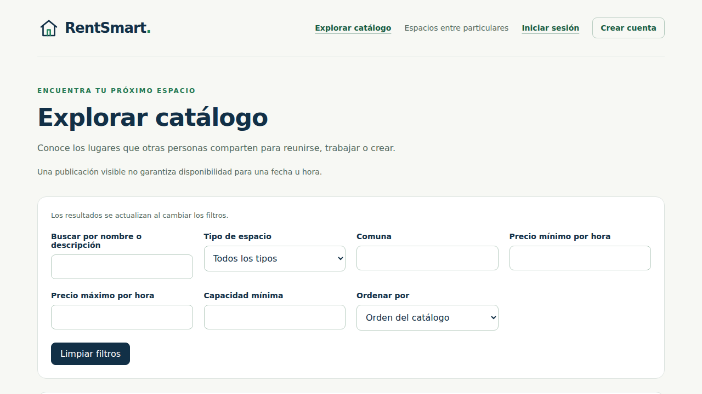

# REN-90 — éxito y fallo E2E real con evidencia

Fecha: **20 de noviembre de 2026**, America/Santiago. [PR #42](https://github.com/JorgeJaceval/Pruebas-De-Software-RentSmart/pull/42), rama `ci/REN-90-fallo-e2e-controlado` hacia develop. Ensayos en runners y recursos temporales, sin publicación al VPS.

## Comparación sobre la misma revisión

HEAD de ambos ensayos: **`b32df21c4605e3eb9e7a3a24a3b5703660d0a0f0`**. La ejecución normal de PR utiliza el merge temporal `cb7c377259fb3ee412bd2871a7eb00c3259d650e`; la manual usa el HEAD directamente. Verificamos mediante Git/GitHub que ambos tienen el mismo árbol **`509f33e8ab21f19947fa3dc27002cab39b7f9011`**. Esto identifica el mismo contenido del repositorio, no garantiza identidad binaria entre builds.

| Comprobación | [Normal #44828334713](https://github.com/JorgeJaceval/Pruebas-De-Software-RentSmart/actions/runs/44828334713) | [Sonda #44828331317](https://github.com/JorgeJaceval/Pruebas-De-Software-RentSmart/actions/runs/44828331317) |
| --- | --- | --- |
| Evento / parámetro | pull_request, sin sonda | workflow_dispatch, failure_probe=e2e |
| Frontend / backend | 150 Jest y 165 Pytest aprobadas | 150 Jest y 165 Pytest aprobadas |
| Infraestructura / smoke | 40 comprobaciones y smoke aprobados | 40 comprobaciones y smoke aprobados |
| Suite funcional E2E | 12 aprobadas, sin fallos/errores/omitidas | Primero 12 aprobadas, sin fallos/errores/omitidas |
| Sonda separada | Excluida, no omitida como caso funcional | 1 aserción fallida deliberadamente; errors0/skipped0 |
| Job e2e | success | failure |
| Quality final | success | **failure**, recoge E2E fallida y emite CI bloqueada |
| Deploy | skipped por PR/ref | skipped por ref, sonda solicitada y controles fallidos |
| Notify / Slack | success, aviso ÉXITO aceptado | success, aviso FALLO aceptado; CI_PROBE_EXECUTED=true |
| Workflow | success | **failure intencional** |

Los doce casos normales continúan siendo doce; la sonda es una comprobación de infraestructura separada. No usamos continue-on-error ni marcamos el fallo como éxito esperado por el framework. La ejecución roja comprueba el control; no documenta un defecto nuevo del producto.

## Aserción y artefactos descargados

Chromium carga el catálogo real y encuentra **«Explorar catálogo»**. La sonda exige deliberadamente **`REN90_EXPECTED_DIFFERENT_HEADING`** mediante `expect(locator).toHaveText`, por lo que falla. El verificador valida marcador y JUnit antes de declarar ejecutado el fallo artificial; no basta que un step esté rojo.

- [Artefacto normal e2e-results, ID 14675386831](https://github.com/JorgeJaceval/Pruebas-De-Software-RentSmart/actions/runs/44828334713/artifacts/14675386831): descargado, JUnit con doce casos sin sonda y HTML presentes.
- [Artefacto negativo e2e-results, ID 14675376964](https://github.com/JorgeJaceval/Pruebas-De-Software-RentSmart/actions/runs/44828331317/artifacts/14675376964): descargado, dos directorios de ejecución independientes, reportes HTML/JUnit, marcador, captura, contexto y trace.zip. Retención configurada: siete días.
- `run-hxmr3D2i`: doce casos aprobados, 12,968664 s de tests, failure_probe=false.
- `run-oi9RPv0H`: una sonda fallida, 2,133555 s, failure_probe=true; `scripts/e2e_probe.py` confirma la aserción. Verificamos integridad ZIP de la traza y presencia de eventos de navegador.
- Ambos directorios manuales informan source_head=b32df21 y source_dirty=false. Los logs registran limpieza de sus proyectos privados. Los tiempos excluyen preparación/build y no constituyen medición de carga.

La captura procede del artefacto de CI fallida y muestra la UI real sin sesión ni credenciales. El desacuerdo está en la aserción artificial; la captura sola no sustituye JUnit, trace o logs del pipeline. No versionamos trazas ni reportes privados completos.

## Bloqueo y notificaciones: alcance de la evidencia

Quality falla en la ejecución negativa pese a que frontend, backend y smoke aprobaron; su entrada E2E es failure. Main y develop exigen ese check según la configuración observada en REN-89. Deploy requiere también quality/E2E success y una ejecución permitida sin sonda.

No ejecutamos una publicación o un merge de prueba en main. En la rama utilizada existen varias condiciones que omiten deploy, de modo que no atribuimos la omisión observada exclusivamente a E2E. Conservamos por separado la evidencia del quality fallido y la revisión/guardas de las condiciones de publicación. No deshabilitamos protecciones para probarlas.

Slack aceptó ambos mensajes con los resultados correspondientes. En el negativo el log de notify confirma CI_PROBE_EXECUTED=true; el notificador incluye «fallo artificial ejecutado por una aserción E2E separada» y el enlace a esa ejecución. No afirmamos confirmación visual del usuario en el canal.

Antes de solicitar revisión dejamos un último commit normal verde; sus checks se registran en PR/Jira. Los cambios posteriores al HEAD de estos ensayos solo documentan esta evidencia y copian la captura. [La guía](../testing/e2e.md) permite reproducir la sonda sin alterar los doce casos normales ni usar producción.
