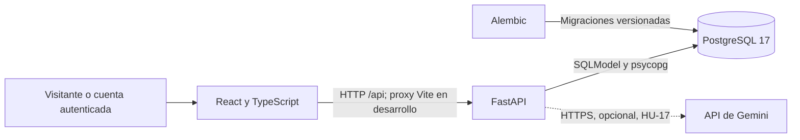
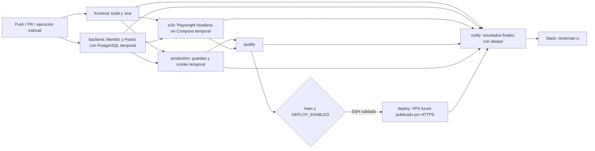

# Arquitectura y tecnologías

El frontend presenta formularios, catálogo, detalle y paneles privados. La API valida las entradas, comprueba la cuenta y sus permisos, calcula los contratos y conserva la información. PostgreSQL respalda relaciones, restricciones y transacciones; el cliente no asigna propietario, precio contratado, privilegios ni estados de reserva.

## Selección de tecnologías y relación con las pruebas

| Tecnología | Propósito y verificación |
| --- | --- |
| React y TypeScript | Interfaz por componentes y contratos tipados; Jest/React Testing Library comprueban interacciones y estados visibles |
| Vite | Servidor, proxy y build; CI verifica tipos y compila la aplicación |
| FastAPI y Pydantic | API y validación; Pytest/TestClient comprueban respuestas, permisos y errores |
| SQLModel, psycopg y PostgreSQL 17 | Persistencia y transacciones; pruebas con PostgreSQL real verifican restricciones, rollback y bloqueos |
| Alembic | Evolución del esquema; CI aplica migraciones y revisa correspondencia con modelos |
| Argon2 y JWT | Hash de contraseñas y sesión con vencimiento; pruebas de autenticación, privacidad y privilegios |
| Docker Compose | Arranque reproducible de frontend, backend y base de datos |
| GitHub Actions | Ejecuta build, migraciones, suites y E2E en PR/push hacia `develop` o `main`; despliega desde `main` |
| Playwright y Chromium | Recorridos E2E headless contra la aplicación completa en un entorno Compose temporal (entrega 3) |
| API de Gemini, nivel gratuito | Sugerencia de descripción (HU-17), llamada solo desde el backend; Pytest usa un proveedor falso y un servidor local que la imita |
| Caddy y Compose de producción | Preparan frontend estático, proxy `/api`, HTTPS y persistencia en un servidor Linux; el job `production` verifica la infraestructura con recursos temporales |

Jest es la herramienta principal de testing seleccionada; Pytest complementa la verificación del backend. Desde la entrega 3, Playwright con Chromium headless ejecuta los recorridos E2E contra la aplicación completa en un entorno Compose temporal; el job `e2e` del pipeline bloquea `quality` y el despliegue si falla. HU-17 agrega la API de Gemini como dependencia externa opcional, llamada solo desde el backend con `GEMINI_API_KEY`. El adaptador corta la llamada completa a los 12 s, lee como máximo 64 KiB, no sigue redirecciones y libera la conexión a la base de datos antes de esperar al proveedor; la API limita a 5 sugerencias por minuto por usuario. Sin clave responde `503` y la interfaz informa que la sugerencia no está disponible. Hoy ni la CI ni producción tienen clave.

## Infraestructura publicada para entrega 2

Conservamos Actions como alternativa permitida a Jenkins. Tras `frontend` y `backend`, el job `production` comprueba las imágenes con PostgreSQL temporal y HTTP local, en paralelo con `e2e` desde la entrega 3. `quality` reúne todos los resultados. El despliegue por SSH exige `quality`, `production` y `e2e` aprobados, `main`, evento push/manual y `DEPLOY_ENABLED=true`.

En el VPS de Azure, Caddy sirve React compilado y envía `/api` a FastAPI; PostgreSQL y la API solo tienen puertos internos. Compose conserva datos y certificados en volúmenes, y Alembic se ejecuta antes de reemplazar la aplicación. El SHA de las imágenes y `/version.json` permiten verificar la publicación junto con readiness.

El 29 de octubre de 2026 publicamos [RentSmart en Azure, Chile Central](https://rentsmart-usm-viveros.chilecentral.cloudapp.azure.com), revisión `ff19bc3` de `main` revisada en PR #28. El segundo intento de Actions autenticó SSH, migró y publicó; comprobamos HTTPS, versión/readiness y contenedores sanos desde el equipo de trabajo. El primer intento había fallado al leer el secreto de clave privada y se conserva como incidencia corregida. La [evidencia](https://github.com/JorgeJaceval/Pruebas-De-Software-RentSmart/blob/develop/docs/evidencias/REN-84-despliegue-2026-10-29.md) y la [guía de despliegue](https://github.com/JorgeJaceval/Pruebas-De-Software-RentSmart/blob/develop/docs/despliegue.md) distinguen publicación real, smoke temporal y recuperación. Las E2E/UI corresponden a la entrega 3.

REN-83 incorpora `notify`, ejecutado al terminar los jobs de CI/CD incluso ante fallos de etapas, para enviar estado, rama, commit y enlace a Slack mediante Incoming Webhook. El secreto está configurado en GitHub como `SLACK_WEBHOOK_URL`; no depende del ambiente de producción del VPS. El canal confirmado es `#rentsmart-ci` del workspace `Rent-Smart-aceval-viveros`. La [guía de notificaciones](https://github.com/JorgeJaceval/Pruebas-De-Software-RentSmart/blob/develop/docs/notificaciones-slack.md) documenta la evidencia de validación real y los límites; las pruebas HTTP simuladas se conservan por separado.

Los jobs omitidos también entregan su estado al notificador. [[Entrega-2]] explica eventos, permisos, evidencia y ubicación de cada servicio; el despliegue está activo únicamente para `main` y cada publicación verifica su SHA/readiness.

## Decisiones relevantes

- Una cuenta normal puede publicar espacios y reservar publicaciones ajenas. La relación con cada recurso determina el permiso.
- Los listados privados filtran por la cuenta verificada en el servidor. Un identificador o parámetro enviado por el navegador no permite consultar otra cuenta.
- Las reservas guardan precio unitario, duración y total del contrato; editar la tarifa del espacio no cambia esos importes.
- Crear reserva y pago pendiente usa un único commit. El bloqueo `SELECT FOR UPDATE` del espacio se comparte con su edición, cambio de estado y eliminación.
- La consulta calcula el estado efectivo según la hora del servidor. Una pendiente vencida deja de bloquear sin depender de que una tarea periódica cambie primero su fila.
- Eliminar requiere ausencia de cualquier reserva histórica. Si existe historial se ofrece desactivar y conservar.

## Estructura y referencias

| Ubicación | Contenido |
| --- | --- |
| `frontend/src/` | Componentes, cliente HTTP y pruebas Jest |
| `backend/app/` | Rutas, modelos, validación y reglas de negocio |
| `backend/tests/` | Pruebas Pytest y fixtures de PostgreSQL |
| `backend/migrations/` | Revisiones Alembic |
| `docs/` | Requerimientos, alcance por HU, identidad y fuentes de Wiki |
| `.github/workflows/ci.yml` | Pipeline de verificación |

El [avance de entrega 2 en develop](https://github.com/JorgeJaceval/Pruebas-De-Software-RentSmart/tree/develop) conserva el historial de integración; PR #34 ya publicó la ampliación funcional en `main`. El tag `v2.0-entrega2` identifica el cierre estable con su documentación final. FastAPI publica el contrato interactivo local en `http://localhost:8000/docs`. Los detalles temporales y transaccionales están en [HU-12](https://github.com/JorgeJaceval/Pruebas-De-Software-RentSmart/blob/develop/docs/HU-12.md) y [HU-16](https://github.com/JorgeJaceval/Pruebas-De-Software-RentSmart/blob/develop/docs/HU-16.md).

PR #34 actualizó esa publicación a `27ba0580232774fc65750c1974485381a1fcffa4` con CA-05 del propietario y migración `0007_cancellation_audit`. [Actions #40967124896](https://github.com/JorgeJaceval/Pruebas-De-Software-RentSmart/actions/runs/40967124896) y [la verificación independiente](https://github.com/JorgeJaceval/Pruebas-De-Software-RentSmart/blob/develop/docs/evidencias/REN-14-despliegue-ca05-2026-10-29.md) comprobaron HTTPS/SHA/readiness, tres contenedores sanos, campos/FK de auditoría y configuración protegida. La demostración local usa el mismo SHA; la aplicación de 0007 conservó los datos sin inventar auditoría histórica.

## Release de entrega 3

El [Release v3.0-entrega3](https://github.com/JorgeJaceval/Pruebas-De-Software-RentSmart/releases/tag/v3.0-entrega3) publica el merge en `main` de PR #{{RELEASE_PR}}. Incluye la migración `0008_space_moderation` de HU-18, que Alembic aplica antes de reemplazar la API; HU-17 no agrega migraciones. El Release registra la verificación del despliegue. La clave de Gemini no está configurada en el servidor, así que la aplicación publicada informa que la sugerencia no está disponible.
