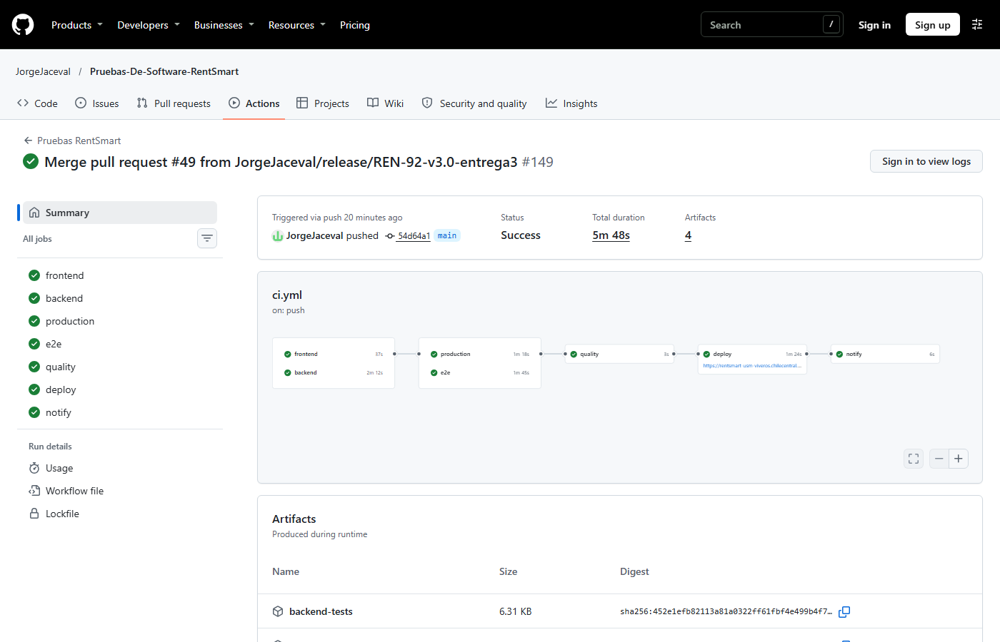
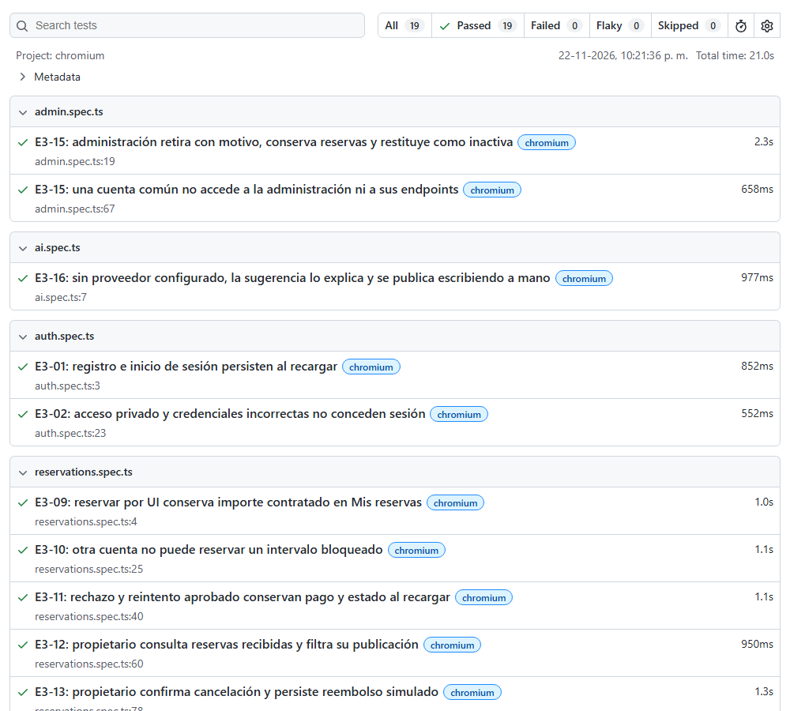
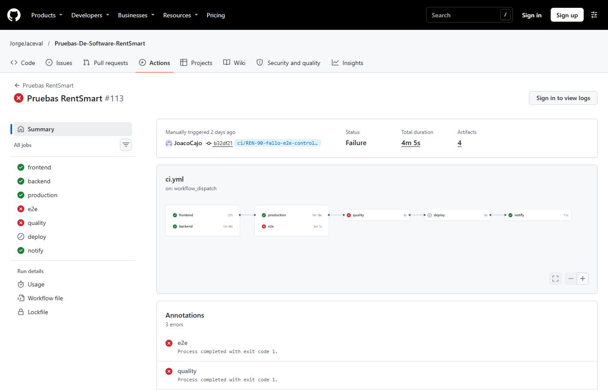
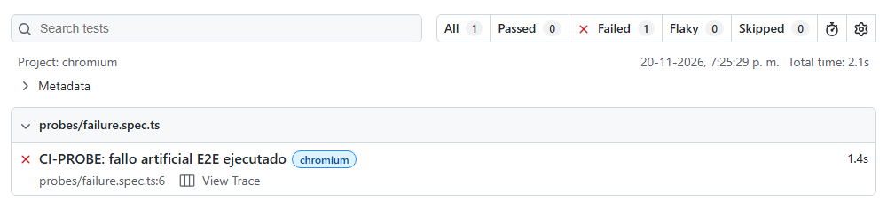

# Entrega 3

[](https://github.com/JorgeJaceval/Pruebas-De-Software-RentSmart/actions/workflows/ci.yml?query=branch%3Amain)

Pruebas E2E con Playwright dentro del pipeline, más los requisitos finales del backlog. Versión: [`v3.0-entrega3`](https://github.com/JorgeJaceval/Pruebas-De-Software-RentSmart/releases/tag/v3.0-entrega3). Pauta: [entrega 3](https://github.com/Pruebas-de-Software/HandsOnProject/blob/main/semestres/2026-2/entrega3.md).

## 1. Objetivo

Cada cambio en el repositorio levanta la aplicación completa, la recorre con un navegador real y marca el build como OK o FAIL. Si una prueba E2E falla, no se puede integrar ni desplegar, y Slack lo avisa.

Además cerramos el backlog:

| Historia | Estado |
| --- | --- |
| HU-15 — el arrendatario cancela su reserva | Integrada (PR #43) |
| HU-09 — filtro por fecha y horario | Integrada (PR #44) |
| HU-18 — moderación de publicaciones | Integrada (PR #45) |
| HU-17 — sugerencia de descripción con IA (Gemini) | Integrada (PR #46). La llamada real a Gemini (CA-08) se probó el 22 de noviembre: [evidencia](https://github.com/JorgeJaceval/Pruebas-De-Software-RentSmart/blob/develop/docs/evidencias/REN-17-ia-real-2026-11-22.md). Sin clave, la app avisa que la sugerencia no está disponible. |

## 2. Herramienta E2E y pipeline

**Playwright + TypeScript + Chromium.** La pauta lo acepta como alternativa a Selenium y no lo habíamos usado. Lo elegimos porque:

- usa el mismo lenguaje que el frontend;
- espera solo a que la página esté lista, sin `sleep`;
- busca elementos por rol y etiqueta (`getByRole`, `getByLabel`), como los ve el usuario, en vez de clases CSS;
- corre headless y deja reporte HTML, JUnit, capturas y trazas.

**¿Por qué GitHub Actions y no Jenkins?** El pipeline de la entrega 2 ya estaba en Actions y funcionando: build, pruebas, migraciones, smoke de contenedores, despliegue a Azure y Slack, con `main` y `develop` protegidas por checks obligatorios. Pasar a Jenkins significaba:

- montar y mantener otro servidor (o cargar la VM de producción) con Java, Docker, plugins, usuarios y HTTPS;
- exponerlo a internet para los webhooks de GitHub, o configurar polling;
- configurar plugins y credenciales para que su resultado llegue a la protección de ramas, algo que Actions hace solo;
- volver a probar todo lo que ya estaba verificado.

Actions, en cambio, nos da en cada ejecución una máquina Ubuntu limpia con Docker, que es justo lo que necesita la E2E para no arrastrar datos entre corridas. Lo que pide la pauta se cumple igual; cada pieza de Jenkins tiene su equivalente:

| En Jenkins | En nuestro pipeline |
| --- | --- |
| Trigger por webhook o polling | `on: pull_request` y `push` a `develop` y `main` |
| Stages en orden | Jobs con `needs`: frontend/backend → e2e + production → quality → deploy → notify |
| Build en FAIL si falla un stage | `quality` falla si `e2e` no aprueba y es check obligatorio del merge |
| `post { always { archiveArtifacts } }` | `upload-artifact` con `if: always()` |
| `slackSend` | Job `notify` con webhook en `#rentsmart-ci` |

Ampliamos esta justificación después de la corrección de la entrega 2.

## 3. Set de pruebas

19 pruebas en 16 casos (el mínimo recomendado es 10). Código en [`frontend/e2e/`](https://github.com/JorgeJaceval/Pruebas-De-Software-RentSmart/tree/develop/frontend/e2e).

| Caso | Qué valida | Escenario |
| --- | --- | --- |
| E3-01 | Registro e inicio de sesión; la sesión sigue al recargar | Login |
| E3-02 | Una vista privada exige sesión; contraseña incorrecta no entra | Permisos |
| E3-03 | Publicar un espacio y verlo en el catálogo y su detalle | CRUD |
| E3-04 | Editar nombre y precio; persiste al recargar | CRUD |
| E3-05 | Eliminar un espacio sin reservas | CRUD |
| E3-06 | Campos vacíos y precio inválido muestran errores | Validaciones |
| E3-07 | Buscar, filtrar, ordenar y limpiar filtros | Búsqueda |
| E3-08 (×2) | Filtro por fecha y horario; reservar vuelve a validar | Búsqueda |
| E3-09 | Reservar y ver el total en Mis reservas | Flujo de negocio |
| E3-10 | Otra cuenta no puede tomar un horario ocupado | Validaciones |
| E3-11 | Pago rechazado y luego aprobado | Flujo de negocio |
| E3-12 | El propietario ve sus reservas recibidas | Navegación |
| E3-13 | El propietario cancela con reembolso simulado | Flujo de negocio |
| E3-14 (×2) | El arrendatario cancela y el horario queda libre | Flujo de negocio |
| E3-15 (×2) | Un admin retira y restituye; un usuario común no entra | Permisos |
| E3-16 | Sin IA configurada, se avisa y se publica a mano | Validaciones |

**Datos:** cada prueba crea sus propias cuentas y datos con nombres aleatorios, así que ninguna depende de otra. Todo corre contra una base PostgreSQL temporal que se borra al final. Solo simulamos una imagen externa; la app, la API y la base son reales.

## 4. Cómo ejecutar en local

Requisitos: Docker con Compose, Node.js 24 y Git Bash o una terminal Linux/macOS.

```bash
cd frontend && npm ci && npx playwright install --with-deps chromium && cd ..
bash scripts/run-e2e.sh
```

El script crea un proyecto Compose con nombre y contraseñas aleatorias, construye las imágenes, aplica migraciones, levanta Caddy + API + PostgreSQL en un puerto libre, exporta `BASE_URL` y corre Playwright headless. Al terminar, pase o falle, guarda los logs y borra contenedores, volúmenes e imágenes. El reporte queda en `frontend/test-results/e2e/run-*/report`.

En Windows con Git Bash: `MSYS2_ARG_CONV_EXCL=/app bash scripts/run-e2e.sh`.

## 5. Integración con CI/CD

- **Dónde:** job `e2e` de [`.github/workflows/ci.yml`](https://github.com/JorgeJaceval/Pruebas-De-Software-RentSmart/blob/develop/.github/workflows/ci.yml).
- **Cuándo:** en cada PR y push a `develop` o `main`. También a mano, con `failure_probe=e2e` para el fallo controlado.
- **OK / FAIL:** `quality` es check obligatorio y falla si `e2e` falla; `deploy` también exige `e2e`. Una E2E rota bloquea merge y despliegue.
- **Variables:** `BASE_URL` sale del puerto temporal y Playwright rechaza destinos no locales, así nunca corre contra producción. `GEMINI_API_KEY` va vacía para no depender de la IA externa.
- **Evidencia:** artefacto `e2e-results` (HTML, JUnit, logs y, si falla, capturas y trazas). Desde esta entrega se guarda 90 días; antes eran 7, así que los artefactos de las ejecuciones citadas caducan a fines de noviembre. Los del release y del fallo controlado están adjuntos al [Release](https://github.com/JorgeJaceval/Pruebas-De-Software-RentSmart/releases/tag/v3.0-entrega3), donde no caducan.
- **Slack:** `notify` publica el resultado de cada job en `#rentsmart-ci`.

## 6. Evidencias

Release en `main` ([CI #45093776011](https://github.com/JorgeJaceval/Pruebas-De-Software-RentSmart/actions/runs/45093776011)): todos los jobs en verde, despliegue incluido. 19 E2E, 185 Jest y 273 Pytest.



Reporte de Playwright de esa ejecución: 19 aprobadas.



**Fallo controlado** ([CI #44828331317](https://github.com/JorgeJaceval/Pruebas-De-Software-RentSmart/actions/runs/44828331317)): una aserción real de Playwright hecha para fallar. `e2e` y `quality` quedan en rojo, así que ese cambio no se podría integrar, y Slack avisa FALLO. `deploy` aparece omitido, pero ahí no prueba nada: la sonda corrió en una rama de prueba, no en `main`. El bloqueo del despliegue está en el propio `deploy`, que exige `needs.e2e.result == 'success'`. [Registro con captura del error y trazas](https://github.com/JorgeJaceval/Pruebas-De-Software-RentSmart/blob/develop/docs/evidencias/REN-90-fallo-e2e-2026-11-20.md).





Artefactos permanentes (adjuntos al Release): [E2E del release](https://github.com/JorgeJaceval/Pruebas-De-Software-RentSmart/releases/download/v3.0-entrega3/e2e-results-main-54d64a1.zip), [E2E del fallo controlado](https://github.com/JorgeJaceval/Pruebas-De-Software-RentSmart/releases/download/v3.0-entrega3/e2e-results-fallo-controlado-44828331317.zip), [Jest](https://github.com/JorgeJaceval/Pruebas-De-Software-RentSmart/releases/download/v3.0-entrega3/frontend-tests-main-54d64a1.zip) y [Pytest](https://github.com/JorgeJaceval/Pruebas-De-Software-RentSmart/releases/download/v3.0-entrega3/backend-tests-main-54d64a1.zip).

Otras ejecuciones: [primera E2E automática](https://github.com/JorgeJaceval/Pruebas-De-Software-RentSmart/actions/runs/44822253194) y [HU-17 integrada](https://github.com/JorgeJaceval/Pruebas-De-Software-RentSmart/actions/runs/44947226199).

## 7. Problemas y soluciones

| Problema | Solución |
| --- | --- |
| Playwright apuntaba a `localhost` fijo | `BASE_URL` obligatoria; se rechazan destinos no locales |
| Las pruebas compartían datos y dependían del orden | Datos únicos por prueba y base temporal; lo comprobamos con `--repeat-each=2 --workers=2` |
| Las fotos venían de servidores externos | Simulamos solo esa imagen |
| Un `exit 1` no prueba que falle una E2E | La sonda es una aserción real, y un script verifica en el JUnit que falló esa aserción |
| El cambio de horario de verano rompía una prueba de fechas | Corregimos el dato de prueba, no la regla |
| E3-15 necesita un admin y el registro no los crea | El script promueve una cuenta ficticia solo en la base temporal |
| Llamar a Gemini en la CI la haría depender de red y cuota | La CI corre sin clave y E3-16 prueba ese caso; las respuestas de la IA se prueban en Jest y Pytest con un proveedor simulado |
| Revisión adversaria de HU-17: tiempo de espera sin mensaje, plazo no total, sin límite por usuario, conexión a la base retenida, entre otros | Corregido, cada uno con su prueba de regresión ([HU-17](https://github.com/JorgeJaceval/Pruebas-De-Software-RentSmart/blob/develop/docs/HU-17.md)) |
| Git Bash cambiaba las rutas de los contenedores | `MSYS2_ARG_CONV_EXCL=/app` en local; en la CI no pasa |

## 8. Pendientes

- **Video:** pendiente; agregamos el enlace al publicarlo.
- **Clave de Gemini en producción:** la llamada real ya está probada en local; falta cargar la clave en el servidor.
- **Jira:** falta un campo de estimación propio (hoy está en la descripción de cada tarea).
- **Jenkins:** ampliamos la justificación (§2); falta saber si el profesor la acepta.
- **Revisión entre integrantes:** desde el 21 de noviembre Joaquín tuvo poca disponibilidad. En PR #48 y #46 pidió cambios: en #48 los atendimos y en #46 pedía la llamada real a Gemini, que hicimos después, cuando tuvimos clave. Jorge descartó esas revisiones para integrar, dejando el motivo en la PR. En #49 Joaquín aprobó, y GitHub descartó la aprobación al subir un cambio de documentación. Bajamos a 0 las aprobaciones obligatorias; integrar sin su aprobación no cumple §4.4 de las reglas generales.
- **Mejoras:** Firefox y WebKit, pruebas visuales y de accesibilidad.

## Uso de IA

Usamos Codex y Claude Code para planificar, programar, probar y documentar. Todo lo validamos corriendo las pruebas en local y en la CI y revisando los cambios. Desde PR #48, además de la revisión de Joaquín, subagentes de IA sin contexto previo revisaron las PR buscando fallas; sus comentarios están en cada PR.
