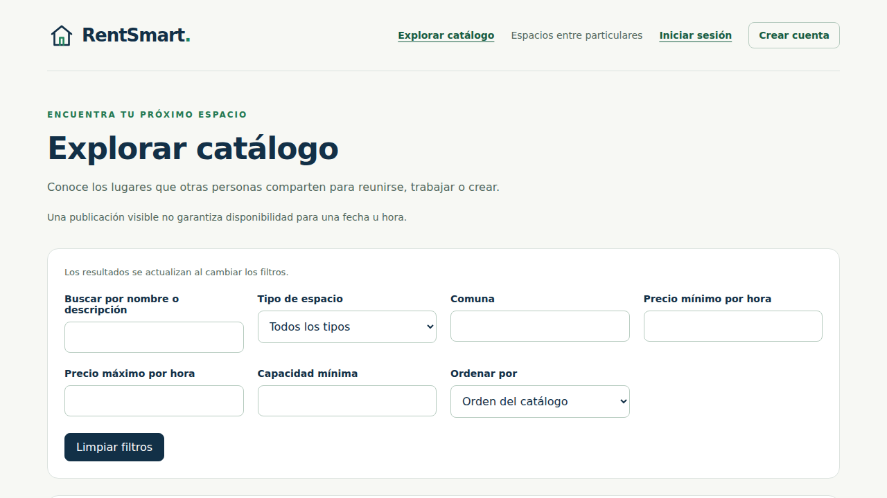

# Entrega 3

Pruebas de interfaz E2E integradas al pipeline de RentSmart. Actualización del **20 de noviembre de 2026**. Fuente versionada: [`docs/wiki/Entrega-3.md`](https://github.com/JorgeJaceval/Pruebas-De-Software-RentSmart/blob/develop/docs/wiki/Entrega-3.md); el [registro acumulativo](https://github.com/JorgeJaceval/Pruebas-De-Software-RentSmart/blob/develop/docs/entrega-3.md) conserva cada paso con su PR, commit y verificación. Pauta: [Entrega 3, semestre 2026-2](https://github.com/Pruebas-de-Software/HandsOnProject/blob/main/semestres/2026-2/entrega3.md).

## 1. Objetivo de la Entrega 3

Sumamos pruebas E2E/UI a la aplicación construida en la entrega 1 e integrada a CI/CD en la entrega 2, y las dejamos corriendo automáticamente en el pipeline. Cada cambio en el repositorio levanta la aplicación completa en un entorno temporal, ejecuta un navegador real sin interfaz visible y marca el build como **OK** o **FAIL**. Un fallo E2E bloquea el despliegue, deja reportes descargables y se informa en Slack.

También completamos los **requisitos finales** del backlog:

| Historia | Estado al 20 de noviembre |
| --- | --- |
| HU-15 / REN-15 — cancelación del arrendatario | Integrada (PR #43); completa CA-03 de HU-13. |
| HU-09 / REN-9 — filtro por fecha y horario | Integrada (PR #44). |
| HU-18 / REN-18 — moderación administrativa | En revisión ([PR #45](https://github.com/JorgeJaceval/Pruebas-De-Software-RentSmart/pull/45)); CI aprobada. |
| HU-17 / REN-17 — sugerencia de descripción con IA (Gemini) | En revisión ([PR #46](https://github.com/JorgeJaceval/Pruebas-De-Software-RentSmart/pull/46)); CI aprobada. Falta la evidencia de una llamada real. |

## 2. Herramienta E2E elegida

Usamos **Playwright con TypeScript y Chromium**. Es una de las alternativas a Selenium que admite la pauta (§1) y el equipo no la había utilizado: en las entregas 1 y 2 solo dejamos la dependencia instalada, sin casos.

Elegimos Playwright porque:
- **Mismo lenguaje:** comparte TypeScript con el frontend, así que reutilizamos sus tipos (`Space`, `Reservation`) en los datos de prueba.
- **Esperas automáticas:** espera los estados observables de la página sin pausas fijas, lo que reduce pruebas inestables.
- **Selectores accesibles:** localiza los elementos por rol y nombre accesible (`getByRole`, `getByLabel`) en vez de clases CSS. Así las pruebas se apoyan en lo que el usuario ve y obligan a mantener la interfaz accesible (Anexo A).
- **Evidencia incluida:** produce reportes HTML y JUnit, capturas y trazas en los fallos, y corre en modo headless en Linux sin configuración adicional.

**Pipeline:** mantenemos **GitHub Actions**, la herramienta de CI/CD de la entrega 2. La pauta de entrega 3 menciona Jenkins (§2.3, §2.4 y DoD). Decidimos continuar con Actions porque ya concentra build, pruebas, migraciones, smoke de infraestructura, despliegue y Slack; migrar exigía montar y mantener un controlador Jenkins y volver a verificar todo el flujo. Cumplimos lo mismo que la pauta exige: ejecución automática ante cambios, entorno levantado por el pipeline, navegador headless, resultado OK/FAIL, bloqueo del despliegue, evidencia y Slack. Presentamos esta decisión al profesor; no la damos por aceptada.

## 3. Set de pruebas E2E

**16 casos integrados en `develop`**, más 3 en revisión (E3-15 en PR #45 y E3-16 en PR #46): **19 al integrar**, por encima del mínimo de 10 recomendado (§2.2). Código en [`frontend/e2e/`](https://github.com/JorgeJaceval/Pruebas-De-Software-RentSmart/tree/develop/frontend/e2e); la [guía E2E](https://github.com/JorgeJaceval/Pruebas-De-Software-RentSmart/blob/develop/docs/testing/e2e.md) relaciona cada caso con sus criterios de aceptación.

| Caso | Qué valida | Escenario de la pauta |
| --- | --- | --- |
| E3-01 | Registrar una cuenta, iniciar sesión y conservarla al recargar. | Login / permisos |
| E3-02 | Una vista privada exige sesión; una contraseña incorrecta no da acceso. | Login / permisos |
| E3-03 | Publicar un espacio y encontrarlo en el catálogo y su detalle. | CRUD: crear, listar, ver |
| E3-04 | Editar nombre y precio y comprobar que persisten al recargar. | CRUD: editar |
| E3-05 | Eliminar un espacio sin reservas; desaparece del panel y del catálogo. | CRUD: eliminar |
| E3-06 | Campos obligatorios vacíos y precio bajo el mínimo muestran errores y no publican. | Validaciones / errores |
| E3-07 | Buscar, combinar tipo, comuna, precio y capacidad, ordenar y limpiar filtros. | Búsqueda / filtro |
| E3-08 (×2) | Filtrar por fecha y horario excluye bloqueos y admite horarios consecutivos; reservar revalida el conflicto. | Búsqueda / filtro |
| E3-09 | Reservar por la interfaz; el total contratado aparece en Mis reservas. | Flujo crítico de negocio |
| E3-10 | Otra cuenta no puede reservar un horario ocupado. | Validaciones / errores |
| E3-11 | Pago simulado rechazado y luego aprobado; el estado persiste al recargar. | Flujo crítico de negocio |
| E3-12 | El propietario consulta reservas recibidas y filtra por publicación. | Navegación clave |
| E3-13 | El propietario cancela una reserva pagada con reembolso simulado. | Flujo crítico de negocio |
| E3-14 (×2) | El arrendatario cancela una reserva pendiente o pagada y el horario queda libre. | Flujo crítico de negocio |
| E3-15 (×2) | La administración retira con motivo y restituye; una cuenta común no accede. | Login / permisos |
| E3-16 | Sin proveedor de IA, la sugerencia lo explica y se publica escribiendo a mano. | Validaciones / errores |

**Estrategia de datos (§2.3):** cada prueba crea sus propias cuentas, espacios y reservas ficticias con identificadores aleatorios, por lo que ninguna depende del orden ni de otra. La API solo prepara datos o contrasta lo guardado; la acción evaluada siempre pasa por el navegador. Toda la ejecución usa una base PostgreSQL temporal que se destruye al terminar. Solo aislamos una imagen externa ficticia (Anexo A); la aplicación, la API y la base de datos son reales.

## 4. Cómo ejecutar local

**Requisitos:** Docker con Compose (en Windows, Docker Desktop con contenedores Linux), Node.js 24, Git Bash o una terminal Linux/macOS.

```bash
cd frontend
npm ci
npx playwright install --with-deps chromium
cd ..
bash scripts/run-e2e.sh
```

El lanzador:
1. Crea un proyecto Compose con nombre aleatorio y contraseñas aleatorias.
2. Construye las imágenes de producción y aplica las migraciones.
3. Levanta Caddy, la API y PostgreSQL en un puerto local libre y comprueba versión y readiness.
4. Exporta `BASE_URL` y ejecuta Playwright en modo headless.
5. Al terminar, con éxito o con fallo, guarda los registros y elimina contenedores, volúmenes e imágenes del proyecto.

Opciones útiles: `bash scripts/run-e2e.sh --repeat-each=2 --workers=2` comprueba la independencia entre casos; `npx playwright show-report <carpeta>/report` abre el reporte HTML. Los reportes quedan en `frontend/test-results/e2e/run-*/` (ignorado por Git).

En Git Bash para Windows ejecutamos `MSYS2_ARG_CONV_EXCL=/app bash scripts/run-e2e.sh`, para que MSYS no convierta las rutas de los contenedores (ver §7).

## 5. Integración con CI/CD

| Elemento | Detalle |
| --- | --- |
| Dónde está | Job `e2e` de [`.github/workflows/ci.yml`](https://github.com/JorgeJaceval/Pruebas-De-Software-RentSmart/blob/develop/.github/workflows/ci.yml), workflow **Pruebas RentSmart**. |
| Qué lo gatilla | Pull request y push hacia `develop` o `main`; ejecución manual (`workflow_dispatch`) con la opción `failure_probe=e2e` para el fallo controlado. |
| Orden | `frontend` y `backend` → `e2e` en paralelo con `production` (smoke de infraestructura) → `quality` → `deploy` (solo `main`) → `notify`. |
| OK / FAIL | `quality`, check obligatorio de la protección de ramas, falla si `e2e` no termina en `success`; `deploy` también exige `e2e` aprobado. Un E2E fallido bloquea el merge y la publicación. |
| Pasos del job | Instala dependencias congeladas y Chromium, ejecuta `scripts/run-e2e.sh`, sube el artefacto `e2e-results` siempre (también ante fallo) y escribe un resumen en la ejecución. |
| Variables | `BASE_URL` (el lanzador la toma del puerto temporal; Playwright rechaza destinos que no sean locales, para no correr nunca contra producción), `E2E_ARTIFACTS_DIR`, `E2E_FAILURE_PROBE` y `GEMINI_API_KEY` forzada vacía para que la CI no dependa de la IA externa. |
| Evidencia | Artefacto `e2e-results` con HTML, JUnit, registros de servicios y, en fallos, capturas y trazas; retención de 7 días. |
| Slack | `notify` informa el resultado de cada job, incluido `e2e`, en `#rentsmart-ci`; un E2E fallido, omitido o cancelado nunca se informa como éxito. |

## 6. Evidencias

| Evidencia | Enlace |
| --- | --- |
| Primera ejecución automática (12 casos) | [CI #44822253194](https://github.com/JorgeJaceval/Pruebas-De-Software-RentSmart/actions/runs/44822253194) · [registro](https://github.com/JorgeJaceval/Pruebas-De-Software-RentSmart/blob/develop/docs/evidencias/REN-89-ci-e2e-2026-11-20.md) |
| Ejecución exitosa comparable | [CI #44828334713](https://github.com/JorgeJaceval/Pruebas-De-Software-RentSmart/actions/runs/44828334713): 12 E2E aprobadas, quality y notify en verde. |
| **Fallo controlado** | [CI #44828331317](https://github.com/JorgeJaceval/Pruebas-De-Software-RentSmart/actions/runs/44828331317): los 12 casos aprueban y una aserción real deliberadamente falsa falla; `e2e` y `quality` en rojo, deploy omitido, Slack informa FALLO. [Registro con captura y trazas](https://github.com/JorgeJaceval/Pruebas-De-Software-RentSmart/blob/develop/docs/evidencias/REN-90-fallo-e2e-2026-11-20.md). |
| Estado integrado en `develop` | [CI #44842992822](https://github.com/JorgeJaceval/Pruebas-De-Software-RentSmart/actions/runs/44842992822) sobre `bc1bd19`: **16 E2E**, 170 Jest y 199 Pytest aprobadas; Slack ÉXITO. Artefacto `e2e-results` 14682535029. |
| Candidatos en revisión | [PR #45, CI #44848349056](https://github.com/JorgeJaceval/Pruebas-De-Software-RentSmart/actions/runs/44848349056): 18 E2E, 176 Jest, 207 Pytest. [PR #46, CI #44851781446](https://github.com/JorgeJaceval/Pruebas-De-Software-RentSmart/actions/runs/44851781446): 17 E2E, 176 Jest, 220 Pytest. |
| Historias integradas | Evidencias de [REN-15](https://github.com/JorgeJaceval/Pruebas-De-Software-RentSmart/blob/develop/docs/evidencias/REN-15-cancelacion-arrendatario-2026-11-20.md) y [REN-9](https://github.com/JorgeJaceval/Pruebas-De-Software-RentSmart/blob/develop/docs/evidencias/REN-9-filtro-temporal-2026-11-20.md). |



Los artefactos de Actions caducan a los 7 días; los registros versionados conservan qué contenían y cómo los verificamos. El cierre registra la ejecución final sobre `main` en el Release `v3.0-entrega3`.

## 7. Problemas encontrados y soluciones

| Problema | Solución |
| --- | --- |
| La configuración de Playwright apuntaba a `localhost` fijo y podía usarse contra cualquier servidor. | `BASE_URL` obligatorio por variable de entorno; la configuración rechaza destinos que no sean HTTP local, de modo que nunca corre contra producción. |
| Las pruebas compartían datos y dependían del orden. | Cuentas y datos ficticios únicos por prueba y una base temporal por ejecución; comprobamos la independencia con `--repeat-each=2 --workers=2`. |
| Las fotos de los espacios dependen de servidores externos. | Interceptamos solo esa imagen ficticia con un SVG fijo; la aplicación y la API siguen siendo reales. |
| Un `exit 1` en el job habría demostrado un paso rojo, no una prueba E2E fallida. | La sonda es una aserción real de Playwright contra la interfaz; `scripts/e2e_probe.py` solo la acredita si el JUnit muestra esa aserción fallida y no un error de preparación. |
| Al llegar a un límite de 90 días, el cambio de horario de verano hacía fallar la expectativa de una prueba (REN-9). | Corregimos el dato de prueba para comprobar el instante exacto; no cambiamos la regla de negocio. |
| Un UUID repetido en los datos de una prueba nueva (REN-15). | Corregimos el dato de prueba. |
| El registro público no puede crear administradores, pero E3-15 los necesita (REN-18). | El lanzador registra una cuenta ficticia y la promueve **solo en la base temporal**. |
| La IA externa haría la CI dependiente de la red y de una cuota (REN-17). | La CI corre sin clave: E3-16 cubre el caso sin proveedor y las sugerencias exitosas se prueban con un proveedor simulado. |
| En Git Bash para Windows, MSYS convertía `/app/.venv/bin/alembic` en una ruta de Windows y el nombre con tilde del administrador llegaba con otra codificación (`400`). | `MSYS2_ARG_CONV_EXCL=/app` al correr localmente y escape JSON `ó` en el nombre. En la CI (Linux) no ocurre. |

## 8. Pendientes y mejoras futuras

- **Integrar PR #45 y #46** y actualizar esta página con la ejecución final sobre `main`, el tag y el Release `v3.0-entrega3`.
- **Evidencia real de IA (HU-17, CA-08):** configurar una clave gratuita de Google AI Studio y registrar una llamada real sin exponerla.
- **Video de entrega 3** a partir del [guion](https://github.com/JorgeJaceval/Pruebas-De-Software-RentSmart/blob/develop/docs/guion-video-entrega-3.md).
- **Jira:** habilitar un campo estructurado de estimación (horas o Story Points); hoy la estimación está en las descripciones.
- **Validación docente** de la continuidad con GitHub Actions en lugar de Jenkins.
- **Mejoras:** ejecutar también en Firefox y WebKit, sumar pruebas visuales y de accesibilidad automatizadas y medir la duración de la suite en el tiempo.

## Uso de inteligencia artificial

Usamos Codex y Claude Code como apoyo para planificar, implementar, probar y documentar; el [registro acumulativo](https://github.com/JorgeJaceval/Pruebas-De-Software-RentSmart/blob/develop/docs/entrega-3.md) detalla qué se generó en cada tarea. Validamos el resultado ejecutando las pruebas localmente y en CI, revisando el diff y con la revisión del compañero antes de cada merge. Somos responsables de entender, probar y explicar todo el código entregado.
